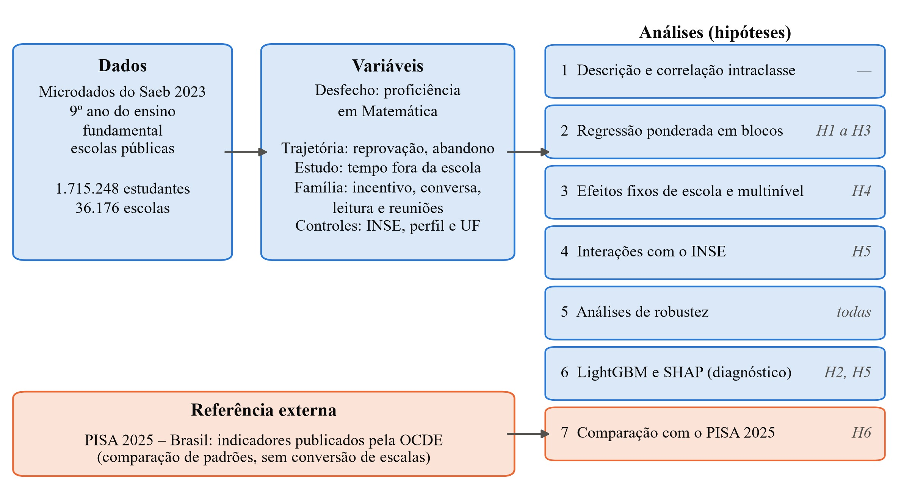

<!--
Versão final da METODOLOGIA (pretérito, como exige o template).
Seguindo a revisão do orientador no artigo de TC: a seção abre com parágrafo (não com subseção),
classifica o estudo justificando cada termo e traz uma figura com o desenho do estudo.
Números: resultados/tab_fluxo_amostra.csv, tab_afe_resumo.csv, tab_pesos.csv.
-->

# METODOLOGIA

Realizou-se um estudo quantitativo, observacional e transversal, de caráter explicativo, com dados secundários de uma avaliação em larga escala. O estudo é observacional porque as variáveis não foram manipuladas pelos pesquisadores, mas registradas pelo Saeb, e transversal porque cada estudante foi observado uma única vez, em 2023. O caráter explicativo decorre do propósito de identificar fatores que contribuem para a variação do desempenho (GIL, 2002), por meio de modelos de associação orientados por hipóteses, e não de prever o desempenho de cada estudante (SHMUELI, 2010). Como não houve manipulação nem acompanhamento ao longo do tempo, os resultados foram interpretados como associações, e não como efeitos causais. A Figura 1 resume o desenho: a fonte de dados, as variáveis e as sete etapas de análise, com as hipóteses a que cada uma responde.

**Figura 1 – Desenho do estudo**

Fonte: elaborada pelos autores (2026).

## Dados e amostra

Os dados vieram dos microdados do Saeb 2023, publicados pelo Inep (INEP, 2024). Utilizou-se a base de estudantes do 9º ano do ensino fundamental, que reúne as proficiências em Língua Portuguesa e Matemática e as respostas ao questionário do estudante, e a base de escolas. Na rede pública, o Saeb 2023 é censitário nessa etapa. O 9º ano foi escolhido por ser a etapa mais próxima da população de 15 anos avaliada pelo PISA e por apresentar respostas ao questionário mais confiáveis que as do 5º ano. As proficiências são estimadas pela Teoria de Resposta ao Item e expressas na escala do Saeb, que tem média 250 e desvio-padrão (DP) 50 na população de referência de 1997; cada estudante tem uma estimativa pontual, com erro-padrão médio de 25 pontos em Matemática. Por exigência da Lei Geral de Proteção de Dados, os códigos de escola e de município são mascarados: permitem agrupar os estudantes por escola, mas não cruzá-los com outras bases, e a Unidade da Federação (UF) é a única variável geográfica com código real.

A amostra seguiu os critérios do Inep para o cálculo dos resultados oficiais, acrescidos do preenchimento do questionário. Dos 2.447.143 registros de escolas públicas, excluíram-se os inconsistentes com o Censo Escolar (13.523), os de estudantes ausentes na prova de Matemática (380.231), os sem proficiência calculada (5.229), os sem peso amostral (142) e os sem questionário (14.737), restando 2.033.281 estudantes de 36.181 escolas. A análise principal usou os 1.715.248 estudantes (84,4%) de 36.176 escolas com resposta em todas as variáveis do modelo. Os estudantes com alguma resposta ausente tiveram proficiência média menor (231,1 contra 253,6 pontos), o que indica que as ausências não são aleatórias; por isso, uma análise de robustez manteve todos os estudantes, tratando a ausência como categoria. Todas as estimativas usaram o peso amostral do estudante em Matemática, que, na rede pública, funciona como ajuste de não resposta (mediana de 1,07).

## Variáveis

O Quadro 1 descreve as variáveis. A trajetória escolar foi representada pela reprovação e pelo abandono, já que o Saeb não registra faltas; a distorção idade-série, isto é, ter 16 anos ou mais no 9º ano, foi usada como alternativa. O INSE, construído pelo Inep a partir dos bens do domicílio e da escolaridade dos responsáveis (ALVES; SOARES; XAVIER, 2014), foi o controle socioeconômico; como já incorpora a escolaridade dos pais, essa informação não entrou separadamente. Variáveis de engajamento e de percepção sobre os professores ficaram fora do modelo, por poderem mediar as associações investigadas.

**Quadro 1 – Variáveis do estudo**

| Grupo | Variável (item do questionário) | Categorias ou medida |
|---|---|---|
| Desfecho | Proficiência em Matemática; em Língua Portuguesa na robustez | Escala Saeb (contínua) |
| Trajetória | Reprovação (Q19) | Nunca (referência); uma vez; duas ou mais |
| Trajetória | Abandono (Q20) | Nunca (referência); uma vez ou mais |
| Estudo | Tempo de estudo fora da escola em dias de aula (Q21a) | Não estuda (referência); menos de 1 h; de 1 a 2 h; mais de 2 h |
| Família | Pais incentivam a estudar, a fazer a tarefa e a comparecer às aulas (Q10c a Q10e) | Índice padronizado (média 0, DP 1) |
| Família | Pais conversam sobre a escola (Q10b), leem em casa (Q10a) e vão às reuniões (Q10f) | Nunca (referência); de vez em quando; sempre |
| Controle | INSE do estudante | Contínua, padronizada |
| Controle | Sexo, cor/raça, deficiência, idade de entrada na escola, trabalho fora de casa, escola rural e capital | Categóricas |
| Controle | UF | Efeitos fixos |

Fonte: elaborado pelos autores com base no dicionário de dados do Saeb 2023 (INEP, 2024).

Os seis itens sobre a família foram submetidos à análise fatorial exploratória, técnica que identifica grupos de itens que medem um mesmo traço, sobre correlações policóricas, adequadas a respostas ordinais. A análise foi feita em uma metade aleatória dos estudantes e replicada na outra. Os três itens de incentivo formaram um fator consistente (cargas de 0,69 a 0,88; ômega de McDonald de 0,85; congruência de Tucker de pelo menos 0,999 entre as metades) e foram combinados em um índice. O planejamento previa um índice de monitoramento com dois itens; a inclusão do incentivo à presença nas aulas decorreu dessa análise. Os itens de leitura e de conversa não formaram um índice confiável (ômega de 0,48) e foram usados separadamente, assim como a ida às reuniões.

## Procedimento de análise

Na primeira etapa, calcularam-se médias ponderadas de proficiência por categoria, com intervalos de confiança de 95% que consideram o agrupamento dos estudantes em escolas, e a correlação intraclasse, parcela da variância da proficiência situada entre escolas. Na segunda, estimaram-se regressões lineares ponderadas por mínimos quadrados ordinários, com blocos acrescentados um a um: controles demográficos e UF (B1), INSE (B2), trajetória (B3), tempo de estudo (B4) e família (B5). A contribuição de cada bloco foi medida pelo acréscimo no coeficiente de determinação (R²), proporção da variância explicada pelo modelo, e os erros-padrão foram agrupados por escola, porque estudantes da mesma escola não são observações independentes.

Na terceira etapa, o modelo B5 foi reestimado com efeitos fixos de escola, especificação que compara apenas estudantes da mesma escola e remove tudo o que é constante nela, como a rede, a infraestrutura e a composição social; a diferença entre os coeficientes dos dois modelos indica quanto de cada associação se deve a diferenças entre escolas. Complementarmente, ajustou-se um modelo multinível de intercepto aleatório (RAUDENBUSH; BRYK, 2002) em uma amostra de 3.000 escolas estratificada por UF, com o INSE do estudante centrado na média da escola e as médias escolares de INSE, de reprovação e de tempo de estudo como preditores da escola. Na quarta etapa, termos de interação entre o INSE e as variáveis de reprovação e de tempo de estudo verificaram se as associações variam com o nível socioeconômico. Na quinta, o modelo B5 foi repetido com Língua Portuguesa como desfecho, sem pesos, com pesos aparados no percentil 99, com a distorção idade-série no lugar da reprovação e com as ausências como categoria.

Na sexta etapa, o aprendizado de máquina teve papel apenas diagnóstico (SHMUELI, 2010). Um modelo de *gradient boosting*, que combina árvores de decisão em sequência e capta relações não lineares e interações sem que precisem ser especificadas, foi ajustado com a biblioteca LightGBM, com as mesmas variáveis do modelo B5, em uma amostra de 300 mil estudantes. Seu desempenho foi comparado ao da regressão linear por validação cruzada em cinco partições agrupadas por escola, de modo que estudantes de uma mesma escola nunca estivessem ao mesmo tempo no treino e no teste. As relações aprendidas foram examinadas por valores SHAP (*SHapley Additive exPlanations*), que repartem cada previsão entre as variáveis (LUNDBERG; LEE, 2017) e não foram lidos como efeitos causais. Na sétima etapa, os padrões do Saeb foram comparados aos indicadores publicados pela OCDE para o Brasil no PISA 2025 (OECD, 2026a, 2026b): a variância associada ao nível socioeconômico, a diferença entre os quartos extremos de nível socioeconômico e a direção das associações. Como as duas avaliações diferem em população, construto, escala, período e tratamento da proficiência (RUTKOWSKI *et al*., 2010), as escalas não foram convertidas uma na outra.

Dado o tamanho da amostra, praticamente todos os coeficientes são estatisticamente significativos; a interpretação apoiou-se, por isso, na magnitude das diferenças, expressas em pontos da escala Saeb e em DP, e nos intervalos de confiança. As análises foram feitas em Python 3.13, com as bibliotecas pandas, statsmodels, pyfixest, factor_analyzer, scikit-learn e lightgbm, em *scripts* numerados e com semente aleatória fixa, que compõem um pacote de replicação disponível em https://github.com/evertonsilvamgs/data-science-uf. Por utilizar apenas microdados públicos e anonimizados, a pesquisa dispensou a apreciação por Comitê de Ética em Pesquisa, nos termos do art. 1º, parágrafo único, incisos II e V, da Resolução CNS nº 510/2016 (BRASIL, 2016). Não houve tentativa de reidentificar escolas ou municípios, e os resultados foram apresentados apenas de forma agregada.

## Limitações

O desenho transversal não permite estabelecer causalidade, e é plausível a causalidade reversa: estudantes com dificuldades podem estudar mais ou receber mais cobrança dos pais. As variáveis do questionário são autodeclaradas, o Saeb não mede a frequência às aulas, e os 380 mil estudantes ausentes na prova podem diferir dos presentes. A proficiência individual contém erro de medida, que tende a atenuar as associações, e os resultados se restringem ao 9º ano da rede pública.
