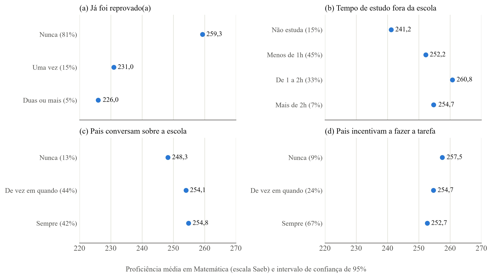
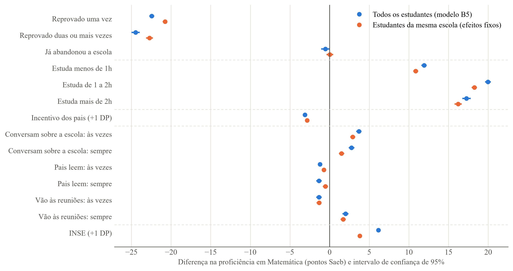
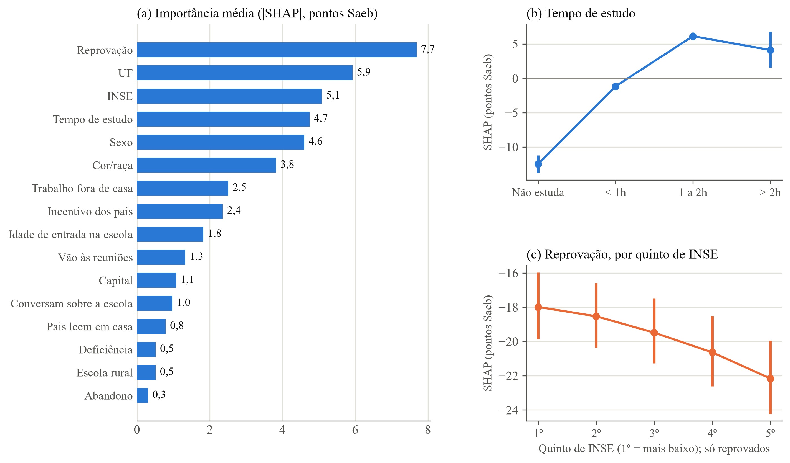

<!--
RESULTADOS. Fontes dos números:
  tab_desfecho.csv, tab_descritivas.csv, tab_icc.csv (etapa 2)
  tab_modelos_ajuste.csv, tab_modelos_coef.csv, tab_multinivel.csv (etapa 3)
  tab_ml_metricas.csv, tab_ml_shap*.csv, tab_pisa_*.csv (etapa 4)
Figuras: analises/06_figuras_artigo.py
-->

# RESULTADOS

## Descrição da amostra

Na amostra analítica, a proficiência média em Matemática foi de 253,6 pontos (DP de 49,4). Entre os estudantes, 19,3% declararam ter sido reprovados ao menos uma vez, 5,4% ter abandonado a escola e 14,8% não estudar fora da escola nos dias de aula. A Figura 2 apresenta as médias de proficiência por categoria. Os estudantes nunca reprovados tiveram média de 259,3 pontos, 28 pontos acima dos reprovados uma vez e 33 acima dos reprovados duas ou mais vezes. A média cresceu com o tempo de estudo até a faixa de 1 a 2 horas (260,8) e foi menor entre os que estudam mais de 2 horas (254,7). Os estudantes cujos pais conversam sobre a escola tiveram médias maiores, enquanto a média diminuiu à medida que aumentou a frequência com que os pais incentivam a fazer a tarefa. A correlação intraclasse foi de 0,17 (0,20 no modelo multinível nulo): cerca de um quinto da variância da proficiência se situa entre escolas, e o restante, entre estudantes da mesma escola.

**Figura 2 – Proficiência média em Matemática por categoria de trajetória, tempo de estudo e envolvimento familiar**

Fonte: elaborada pelos autores a partir dos microdados do Saeb 2023 (INEP, 2024).

## Modelos em blocos

A Tabela 1 apresenta a variância explicada em cada modelo. Sozinho, o INSE explicou 4,1% da variância da proficiência. A trajetória escolar foi o bloco que mais acrescentou à explicação (3,5 pontos percentuais), seguida do INSE (1,8) e do tempo de estudo (1,4); o envolvimento familiar acrescentou 0,4 ponto. O modelo completo explicou 15,3% da variância, e a inclusão dos efeitos fixos de escola elevou esse valor para 26,6%.

**Tabela 1 – Variância da proficiência em Matemática explicada pelos modelos**

| Modelo | Variáveis incluídas | R² (%) | Acréscimo (p.p.) |
|---|---|---|---|
| B0 | Somente INSE | 4,1 | – |
| B1 | Controles demográficos e UF | 8,2 | – |
| B2 | B1 + INSE | 10,0 | 1,8 |
| B3 | B2 + trajetória escolar | 13,5 | 3,5 |
| B4 | B3 + tempo de estudo | 14,9 | 1,4 |
| B5 | B4 + envolvimento familiar | 15,3 | 0,4 |
| B5 com efeitos fixos | B5 + uma constante por escola | 26,6 | – |

Fonte: elaborada pelos autores a partir dos microdados do Saeb 2023 (INEP, 2024).

A Figura 3 apresenta os coeficientes do modelo B5, que indicam a diferença de proficiência associada a cada categoria em relação à de referência, mantidos constantes os demais fatores. Ter sido reprovado uma vez associou-se a 22,4 pontos a menos (0,45 DP), e duas ou mais vezes, a 24,5 pontos a menos (0,50 DP). O abandono, depois de considerada a reprovação, teve associação próxima de zero (−0,5 ponto). Em relação a quem não estuda fora da escola, estudar menos de 1 hora associou-se a 11,9 pontos a mais, de 1 a 2 horas, a 20,0 pontos (0,40 DP), e mais de 2 horas, a 17,3 pontos. Entre as práticas familiares, conversar sobre a escola de vez em quando ou sempre associou-se a 3,7 e 2,8 pontos a mais, e cada DP do índice de incentivo, a 3,1 pontos a menos (0,06 DP); a leitura dos pais e a ida às reuniões tiveram associações de até 2 pontos, em direções diferentes. O coeficiente do INSE caiu de 10,0 pontos por DP, quando sozinho, para 6,2 no modelo B5.

**Figura 3 – Coeficientes do modelo B5 e do modelo com efeitos fixos de escola**

Fonte: elaborada pelos autores a partir dos microdados do Saeb 2023 (INEP, 2024).

## Comparação dentro das escolas e heterogeneidade

Na comparação entre estudantes da mesma escola, as associações de reprovação, tempo de estudo e incentivo mantiveram mais de 90% da magnitude: a reprovação passou para −20,8 pontos, o estudo de 1 a 2 horas para 18,3 e o incentivo para −2,8 (Figura 3). As associações que mais diminuíram foram a do INSE, de 6,2 para 3,8 pontos (−38%), e a de conversar sempre sobre a escola, de 2,8 para 1,5. No modelo multinível, a média de INSE da escola associou-se a 9,3 pontos por DP, além dos 4,0 pontos do INSE do próprio estudante em relação a essa média, e a proporção de reprovados na escola, a −2,5 pontos por DP. As variáveis explicaram 30,7% da variância entre escolas e 10,0% da variância dentro delas.

A associação da reprovação variou com o nível socioeconômico, mas foi mais intensa entre os estudantes de INSE mais alto: cada DP de INSE acrescentou −3,3 pontos à diferença associada a uma reprovação e −4,5 pontos à de duas ou mais. A diferença estimada para uma reprovação foi, assim, de cerca de −18,0 pontos para um estudante 1 DP abaixo da média de INSE e de −24,6 pontos para um estudante 1 DP acima. As interações com o tempo de estudo foram pequenas, de no máximo 1,3 ponto por DP.

Os resultados foram estáveis nas análises de robustez. Com Língua Portuguesa como desfecho, a reprovação associou-se a −22,2 pontos, o estudo de 1 a 2 horas a 23,1 e o incentivo a −2,8. Sem pesos, com pesos aparados ou com as ausências como categoria, os coeficientes variaram no máximo 1,5 ponto, e a distorção idade-série, no lugar da reprovação, associou-se a −20,9 pontos.

## Diagnóstico com aprendizado de máquina

Na validação cruzada, o LightGBM obteve R² de 0,174 fora da amostra, contra 0,154 da regressão linear, e raiz do erro quadrático médio de 44,9 contra 45,4 pontos. O ganho, de 2 pontos percentuais, indica que a especificação linear capta a maior parte da relação entre as variáveis e a proficiência. A Figura 4 mostra que a reprovação foi a variável de maior importância média, seguida da UF, do INSE e do tempo de estudo, e que as práticas familiares tiveram importância menor. O modelo reproduziu a interrupção dos ganhos acima de 2 horas de estudo e a associação mais negativa da reprovação entre os estudantes de INSE mais alto, de −18 pontos no quinto mais baixo a −22 no mais alto.

**Figura 4 – Diagnóstico com LightGBM: (a) importância média das variáveis; (b) contribuição do tempo de estudo; (c) contribuição da reprovação, por quinto de INSE (média e intervalo entre o primeiro e o terceiro quartis)**

Fonte: elaborada pelos autores a partir dos microdados do Saeb 2023 (INEP, 2024).

## Comparação com o PISA 2025

O Quadro 2 confronta os padrões do Saeb 2023 com os indicadores do PISA 2025 para o Brasil. Nas dimensões comparáveis, as associações tiveram a mesma direção. A parcela da variância associada ao nível socioeconômico foi menor no Saeb, mas mais que dobrou quando se incluíram as escolas privadas; além disso, a confiabilidade aproximada da proficiência individual, entre 0,73 e 0,79, indica que parte da diferença decorre do erro de medida.

**Quadro 2 – Padrões do Saeb 2023 e indicadores do PISA 2025 para o Brasil**

| Dimensão | Saeb 2023 (9º ano, escolas públicas) | PISA 2025 (Brasil) | Direção |
|---|---|---|---|
| Variância associada ao nível socioeconômico | 4,1% (INSE); 9,7% com as escolas privadas | 16% (índice ESCS, em Ciências); OCDE: 12% | Mesma; menor no Saeb |
| Diferença entre os quartos extremos de nível socioeconômico | 0,52 DP; 0,79 DP com as escolas privadas | 96 pontos em Ciências; OCDE: 85 | Mesma |
| Interesse dos pais pelo dia a dia escolar | Conversar sobre a escola: 2,8 a 3,7 pontos a mais | Associação positiva com o desempenho na média da OCDE | Mesma |
| Incentivo e cobrança dos pais | 3,1 pontos a menos por DP do índice | Conversas sobre o futuro educacional associadas a menor desempenho na média da OCDE | Mesma |
| Reprovação | 22,4 pontos a menos (0,45 DP) | Não analisada no Volume I; maior coeficiente negativo no PISA 2022 | Mesma (PISA 2022) |
| Frequência às aulas | Não medida | 55% faltaram ao menos um dia em duas semanas; faltas associadas a menor desempenho | Não comparável |

Fonte: elaborado pelos autores a partir dos microdados do Saeb 2023 (INEP, 2024), de OECD (2026a, 2026b) e de Cito e Marôco (2026).
